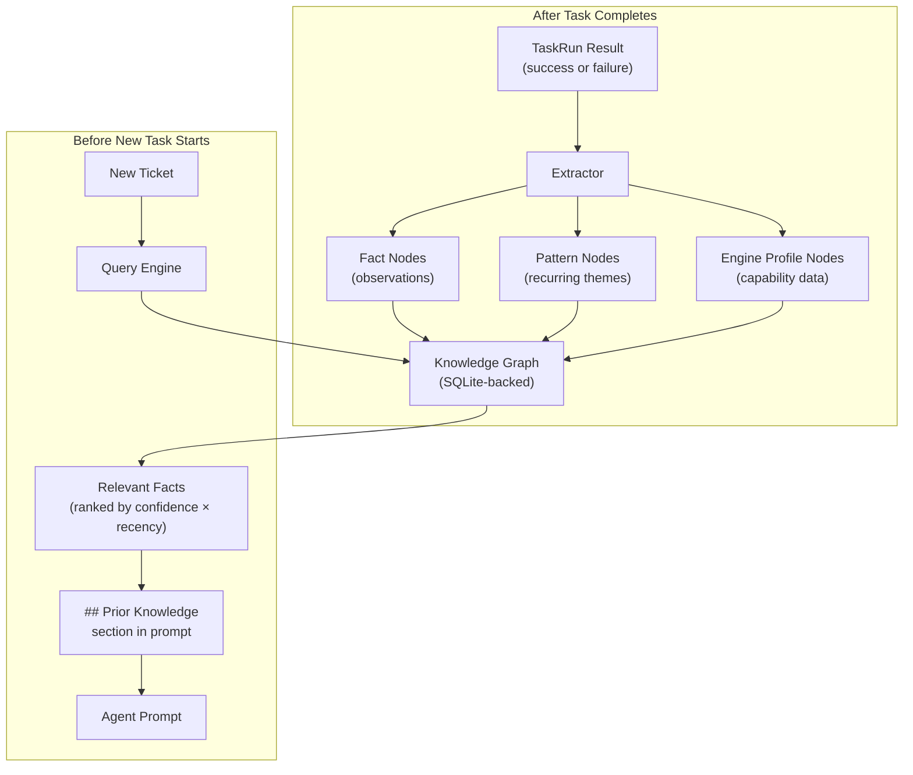

# Episodic memory

Episodic memory collects structured knowledge from every completed task, successful or not, and adds relevant prior knowledge to future task prompts. Over time it records which approaches work, which repositories have quirks, and which engines struggle with specific task types.

## Why memory matters

Without memory, every task starts from scratch. The same mistakes are repeated, the same workarounds are rediscovered, and what the team has learned lives only in people's heads. With memory enabled, Osmia keeps a growing knowledge base that later tasks can draw on.

What it gives you:

- Knowledge from each completed task is available to the next one.
- Knowledge is shared across engines: what a Claude Code task learns is available to an Aider task, and the reverse.
- Earlier failure patterns are surfaced before they recur ("this repo has a known flaky test in `auth_test.go`").
- Knowledge decays over time as repositories change, so stale facts do not mislead agents.
- Isolation per use case: what the ticketing flow learns is never offered to incident triage, or the reverse.

## How it works

Memory works in two phases: extraction (after a task completes) and injection (before a new task starts).



### Extraction

When a task completes (successfully or not), the controller runs the memory extractor in a background goroutine. The extractor analyses the TaskRun metadata and produces:

Fact nodes are specific observations with confidence scores:

- "Repo `org/backend` requires `go mod tidy` after dependency changes" (confidence: 0.85)
- "Claude Code failed on `org/monorepo` due to repository size" (confidence: 0.70)
- "Test `TestAuthFlow` in `org/api` is flaky, with intermittent timeouts" (confidence: 0.60)

Pattern nodes are recurring observations across several tasks:

- "Bug fix tasks on Python repositories succeed 90% of the time with Claude Code"
- "Documentation tasks rarely need more than 10 minutes"

Engine profile nodes are per-engine capability summaries:

- "Claude Code: strong at Go refactoring, weak at large monorepos"
- "Aider: fast for small changes, slower for multi-file refactors"

### Temporal decay

Knowledge goes stale. Repositories change, flaky tests get fixed, and engine capabilities change with each release. Memory applies temporal decay:

1. Each fact has a confidence value (0.0–1.0) and a decay rate.
2. A background goroutine runs at a configurable interval (default: 24 hours) and multiplies each fact's confidence by `(1 - decay_rate)`.
3. Facts whose confidence drops below the prune threshold (default: 0.05) are permanently removed.

The knowledge graph stays current without manual curation.

### Query and injection

Before building an execution spec for a new task, the controller queries memory:

1. The query engine searches the graph for facts relevant to the ticket's description, repository and engine
2. Results are ranked by `confidence × recency_weight`
3. The top facts are formatted into a `## Prior Knowledge` section
4. This section is injected into the agent's prompt via the `MemoryContext` field on `engine.Task`

The prompt builder includes the memory section after the guard rails and before the engine identifier, so the agent reads it as part of its briefing.

## Configuration

Enable memory in your `osmia-config.yaml`:

```yaml
memory:
  enabled: true
  store_path: "/data/memory.db"       # SQLite database path
  decay_interval_hours: 24            # Hours between decay cycles
  prune_threshold: 0.05               # Remove facts below this confidence
  max_facts_per_query: 10             # Maximum facts injected per prompt
```

### Configuration fields

| Field | Type | Default | Description |
|---|---|---|---|
| `enabled` | bool | `false` | Enables episodic memory |
| `store_path` | string | `/var/lib/osmia/memory.db` | Path to the SQLite database file |
| `decay_interval_hours` | int | `24` | Hours between confidence decay cycles |
| `prune_threshold` | float | `0.05` | Facts below this confidence are pruned |
| `max_facts_per_query` | int | `10` | Maximum facts returned per query |
| `tenant_isolation` | bool | `true` | Not read. Isolation is unconditional; see [Multi-tenant isolation](#multi-tenant-isolation) |

### Storage

Memory uses SQLite via `modernc.org/sqlite`, a pure Go implementation with no CGO dependency. The database is created automatically on first use, with auto-migration. In production, point `store_path` at persistent storage (for example a PVC).

!!! tip "Use a PersistentVolumeClaim"
    In Kubernetes, mount a PVC at the `store_path` directory so memory survives pod restarts:
    ```yaml
    # In your Helm values.yaml
    persistence:
      memory:
        enabled: true
        size: 1Gi
        mountPath: /data
    ```

## Node types

### Facts

The basic unit of knowledge. Each fact is a single observation with metadata:

| Field | Description |
|---|---|
| `content` | The observation text (e.g. "repo X has a flaky test Y") |
| `fact_kind` | Category: `success_pattern`, `failure_pattern`, `repo_quirk`, `general` |
| `confidence` | Current confidence (0.0–1.0), decays over time |
| `decay_rate` | Per-cycle decay factor (e.g. 0.05 = 5% decay per cycle) |
| `valid_from` | When this fact was observed |
| `tenant_id` | Owning tenant for isolation |

### Patterns

Higher-level observations derived from multiple facts:

| Field | Description |
|---|---|
| `description` | The pattern description |
| `frequency` | How often this pattern has been observed |
| `confidence` | Statistical confidence in the pattern |

### Engine Profiles

Per-engine capability summaries built from historical outcomes:

| Field | Description |
|---|---|
| `engine` | Engine name (e.g. "claude-code") |
| `strengths` | Areas where the engine excels |
| `weaknesses` | Areas where the engine struggles |
| `sample_count` | Number of tasks the profile is based on |

## Edge relations

Nodes are connected by typed edges:

| Relation | Meaning |
|---|---|
| `relates_to` | Two facts are about the same topic |
| `contradicts` | Two facts conflict (newer one has higher confidence) |
| `supersedes` | A fact replaces an older one |

## Prometheus metrics

| Metric | Type | Labels | Description |
|---|---|---|---|
| `osmia_memory_nodes_total` | Gauge | `type` | Total nodes in the graph by type |
| `osmia_memory_queries_total` | Counter | `engine` | Total memory queries |
| `osmia_memory_extractions_total` | Counter | `outcome` | Total extraction runs by task outcome |
| `osmia_memory_confidence_distribution` | Histogram | None | Distribution of fact confidence values |

## Architecture

```
internal/memory/
├── types.go       — Node, Edge, and MemoryContext type definitions
├── graph.go       — Thread-safe knowledge graph with decay and pruning
├── store.go       — SQLiteStore with auto-migration
├── extractor.go   — Heuristic post-task knowledge extraction
├── query.go       — QueryEngine with temporal-weighted retrieval
└── *_test.go      — Unit tests
```

## Multi-tenant isolation

Memory is partitioned by tenant:

- Extraction tags every new node with the originating TaskRun's tenant.
- Queries return only the requesting tenant's nodes.
- Decay and pruning run across all tenants (stale facts are pruned regardless of tenant).

### What a tenant is here

A tenant is a use case, not a customer. The controller assigns one automatically from the flow that created the TaskRun:

| Flow | Tenant |
|---|---|
| Ticket to merge request | `ticketing` |
| Incident triage | `incident-triage` |

So what one flow learns is never offered to the other: an incident classification does not surface in a code-change prompt, and vice versa. There is no per-customer or per-repository partition, and no way to configure one. Because the partition is by use case rather than by deployment, it still holds if the two flows are ever consolidated into a single binary.

!!! warning "`tenant_isolation` is not read"
    The `tenant_isolation` config field is declared but nothing reads it. Isolation is unconditional and cannot be turned off. Setting it to `false` has no effect.

A query made with no tenant matches every node regardless of tenant. That path is for whole-graph administrative reads. Every query the controller makes is tenanted.

Facts written before tenanting existed carry no tenant, so a tenanted query does not return them. In practice the graph re-accumulates within a few runs.

## Backwards compatibility

Memory is disabled by default. When disabled:

- No SQLite database is created
- No background goroutines run
- No memory context is injected into prompts
- There is no overhead on the controller

Enabling memory changes nothing else: existing TaskRuns and prompts are unaffected.

## Example: what an agent sees

When memory is enabled and has accumulated knowledge, a new task prompt might include:

```markdown
## Prior Knowledge

The following observations from previous tasks may be relevant:

- **Failure pattern** (confidence: 0.82): The `auth` package in this repository
  has a known race condition in `TestConcurrentLogin` — run tests with `-count=1`
  to avoid false failures.
- **Success pattern** (confidence: 0.75): Previous bug fixes in this repository
  succeeded by focusing changes on the `internal/handler/` directory.
- **Engine note** (confidence: 0.68): Claude Code handles Go refactoring tasks
  well in this repository but struggles with the frontend TypeScript code.
```

## Future work

- LLM-based extraction (v2): replace heuristic extraction with an LLM call using `internal/llm/` for richer, more nuanced knowledge extraction
- Provenance tracking: include the source TaskRun ID in injected facts so agents can reference the original context
- Memory dashboard: visualise the knowledge graph in the web UI, showing fact relationships and confidence trends
