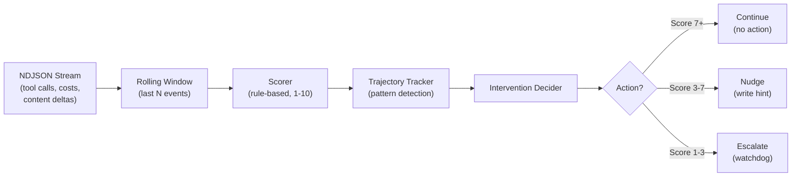

# Real-time agent coaching (PRM)

The Process Reward Model (PRM) scores an agent's work while it runs. It reads the NDJSON event stream, scores each step, detects trajectory patterns, and intervenes before small problems become expensive failures.

## Why PRM matters

Without real-time coaching, an agent can spend 30 minutes and $15 going in circles before anyone notices. The PRM catches unproductive patterns within seconds and writes targeted guidance, which can turn a failed $15 run into a successful $5 run.

What it gives you:

- Early detection of repetitive loops, stalls and declining productivity.
- Specific hints rather than a generic "try again".
- Lower token spend on failing tasks, by up to 60%.
- No change to the agent: it works only on observable telemetry, with any engine that produces an event stream. Today that is Claude Code only.
- Configurable thresholds, so you can tune sensitivity per environment.

## How it works

The PRM is a pipeline that runs alongside the agent's event stream:



### 1. Event collection

When streaming is enabled, Claude Code emits an NDJSON event stream containing tool calls, content deltas, cost updates, and results. The PRM's event processor is wired into the `agentstream.Forwarder` via `WithEventProcessor`, so it receives every event in real time without buffering the whole stream.

### 2. Scoring

The scorer evaluates a rolling window of recent tool calls. It considers:

| Signal | Effect on score |
|---|---|
| Diverse tool usage (Read → Edit → Bash) | Increases score (productive pattern) |
| Repetitive tool calls (Bash → Bash → Bash) | Decreases score (likely looping) |
| File progress (new files read/edited) | Increases score |
| No progress (same files repeatedly) | Decreases score |
| Tool call frequency | Very high frequency with no file changes penalised |

Scores range from 1 (completely unproductive) to 10 (highly productive). The scorer runs every `evaluation_interval` events (default: 5).

### 3. Trajectory pattern detection

Individual scores are tracked over time in a trajectory. The PRM detects four patterns:

| Pattern | Description | Typical cause |
|---|---|---|
| Sustained decline | 3+ consecutive score drops | Agent going off-track |
| Plateau | 5+ identical low scores | Agent stuck in a loop |
| Oscillation | Alternating up/down scores | Agent undoing and redoing work |
| Recovery | 3+ consecutive score increases | Agent self-correcting (good) |

### 4. Intervention

Based on the current score and trajectory pattern, the decider chooses one of three actions:

- Continue: the agent is productive, so no action is needed.
- Nudge: log a structured hint with specific guidance (for example, "Consider a different approach. You've been editing the same file 8 times without running tests").
- Escalate: log that the agent needs stronger intervention. The controller defers this to the watchdog but does not act on it directly yet, so an escalation alone does not stop the job.

## Configuration

Enable PRM in your `osmia-config.yaml`:

```yaml
prm:
  enabled: true
  evaluation_interval: 5        # Evaluate every N tool calls
  window_size: 10               # Rolling window of recent events
  score_threshold_nudge: 7      # Below this, a declining or stuck agent gets a hint
  score_threshold_escalate: 3   # At or below this, a sustained decline is escalated
  hint_file_path: "/workspace/.osmia-hint.md"
  max_trajectory_length: 50     # Maximum trajectory points stored
```

### Configuration fields

Any field you leave out takes the default below. A field set to zero is treated as left out, and so are negative values for `evaluation_interval`, `window_size` and `max_trajectory_length`.

| Field | Type | Default | Description |
|---|---|---|---|
| `enabled` | bool | `false` | Enables PRM scoring of agent tool calls |
| `evaluation_interval` | int | `5` | Number of tool calls between evaluations |
| `window_size` | int | `10` | Number of recent events in the scoring window |
| `score_threshold_nudge` | int | `7` | Below this score, a declining trend, oscillation or plateau produces a nudge |
| `score_threshold_escalate` | int | `3` | At or below this score, a sustained decline produces an escalation |
| `hint_file_path` | string | `/workspace/.osmia-hint.md` | Path where hints are written in the agent pod |
| `max_trajectory_length` | int | `50` | Maximum number of trajectory points retained |

### Tuning tips

- Start conservative: set `score_threshold_nudge: 5` and `score_threshold_escalate: 2` to avoid false positives, then tighten thresholds as you observe real agent behaviour
- Increase `window_size` for long-running tasks (60+ minutes) to smooth out natural variations
- Decrease `evaluation_interval` for expensive engines where early detection saves more money

## Prometheus metrics

The PRM exposes these metrics:

| Metric | Type | Labels | Description |
|---|---|---|---|
| `osmia_prm_step_scores` | Histogram | `engine` | Distribution of step scores (1-10) |
| `osmia_prm_interventions_total` | Counter | `action` | Total interventions by type (continue/nudge/escalate) |
| `osmia_prm_trajectory_patterns_total` | Counter | `pattern` | Trajectory pattern detections |

## Architecture

The PRM lives in `internal/prm/`:

```
internal/prm/
├── scorer.go          — Rule-based step scoring
├── trajectory.go      — Pattern detection across score history
├── intervention.go    — Intervention types and decision logic
├── evaluator.go       — Orchestrates the full PRM pipeline
└── *_test.go          — Table-driven unit tests
```

The controller creates one `prm.Evaluator` per active TaskRun when PRM is enabled. The evaluator is stored in a thread-safe map and cleaned up when the job completes or fails.

## Backwards compatibility

PRM is disabled by default and has no overhead when disabled. The controller behaves as it would without a PRM: no extra goroutines, no scoring, no evaluator allocation. Enabling PRM changes nothing else.

## Future work

- LLM-based scoring (v2): replace the rule-based scorer with an LLM call using the `internal/llm/` package for richer, more contextual evaluation
- Pod-level hint delivery: write hints directly to the agent pod via a projected ConfigMap volume
- Escalation-to-watchdog integration: direct signalling from PRM escalation to watchdog termination
