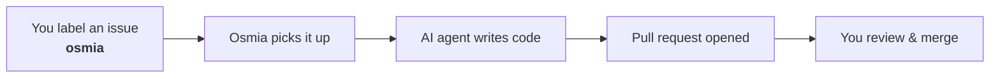
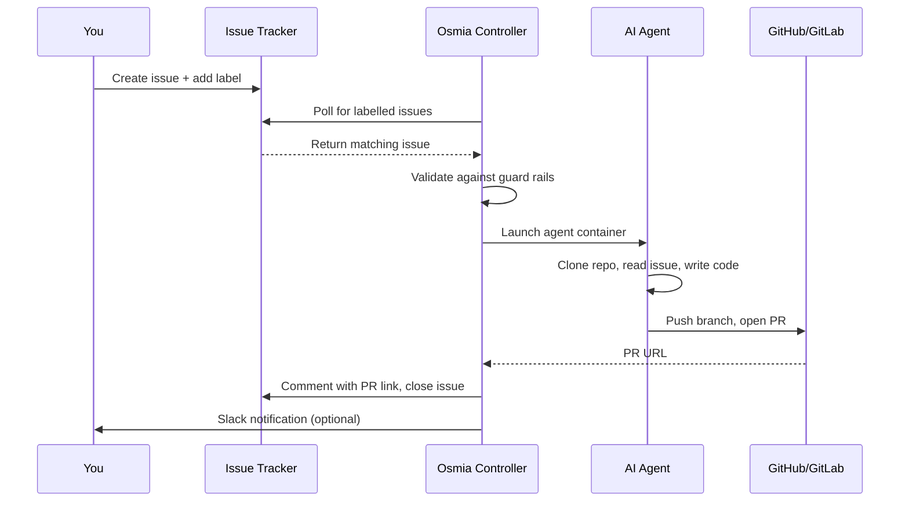

# What is Osmia?

Osmia is an open-source tool that connects your issue tracker to AI coding agents. When you label an issue, Osmia picks it up, runs an AI agent (like Claude Code or Codex) against your codebase, and opens a pull request with the result. It schedules the work, enforces safety rules, retries on failure and notifies your team.

## The happy path

That is the core workflow. Guard rails, multiple engines, plugins and scaling all build on this loop.

## What problems does it solve?

**Repetitive maintenance tasks pile up.** Dependency upgrades, test fixes, documentation updates, small bug fixes. These tasks are well defined but tedious. They sit in backlogs for weeks because humans have higher-priority work.

**Running AI agents by hand does not scale.** You can open Claude Code or Codex locally and give it a task, but that ties up your machine and your attention. You can't run ten tasks in parallel, and you can't enforce consistent safety rules.

**Teams need guard rails.** Letting an AI agent change a production codebase calls for cost limits, file access controls, audit logging and human approval. Osmia provides these.

## How it works (no Kubernetes jargon)

1. **You create an issue** in GitHub, GitLab or Jira describing a task.
2. **You add a label** (e.g. `osmia`) to signal that Osmia should handle it.
3. **Osmia's controller** notices the label, checks safety rules, and decides which AI agent to use.
4. **A container starts** running the AI agent with your codebase checked out.
5. **The agent works.** It reads code, makes changes and runs tests.
6. **A pull request is opened** with the agent's changes, and the original issue is updated with a link.
7. **You review the PR** like any other: approve, request changes or close.

## What are guard rails?

Guard rails are safety boundaries that stop the AI agent doing things it should not. Osmia has six independent layers:

1. **Controller validation** checks the issue against rules before starting (allowed repos, task types, concurrent job limits).
2. **Engine hooks** intercept dangerous commands (like `rm -rf` or `sudo`) before they run.
3. **Repository rules** are a `guardrails.md` file in your repo that tells the agent what it must never do.
4. **Task profiles** give different task types different permissions (e.g. documentation tasks can only edit `.md` files).
5. **Quality gate** is an optional review step that checks the agent's output for security issues before the PR is created.
6. **Progress watchdog** monitors the agent while it runs and stops it if it gets stuck in a loop or uses tokens without making progress.

The layers work independently, so a failure in one does not compromise the others. See [Guard Rails Overview](guardrails-overview.md) for details.

## What are engines?

An engine is an AI coding tool that Osmia can run. The controller does not write code itself. It delegates to engines:

| Engine | What it is |
|---|---|
| **Claude Code** | Anthropic's CLI coding agent (recommended) |
| **Codex** | OpenAI's coding agent |
| **Aider** | Open-source AI pair programming tool |
| **OpenCode** | Terminal-based, supports multiple LLM providers |
| **Cline** | MCP and AWS Bedrock support *(community template, no pre-built image)* |

You configure a default engine and optional fallbacks. If one engine fails, the next is tried automatically. See [Engines Explained](engines.md) for a comparison.

## What are plugins?

Plugins let Osmia connect to different services. There are six types:

| Plugin type | What it connects to |
|---|---|
| **Ticketing** | GitHub Issues, GitLab Issues, Jira, Shortcut |
| **Notifications** | Slack, Microsoft Teams, Discord, email |
| **Secrets** | Kubernetes Secrets, HashiCorp Vault, AWS Secrets Manager |
| **SCM** | GitHub, GitLab (for cloning repos and opening PRs) |
| **Approval** | Human-in-the-loop approval workflows |
| **Review** | CodeRabbit, Semgrep (automated code review) |

Built-in plugins, such as GitHub Issues and Slack, ship with Osmia. You can write custom plugins in any language that supports gRPC. See [Writing a Plugin](../plugins/writing-a-plugin.md).

## Do I need Kubernetes?

For production use, yes: Osmia runs as a Kubernetes operator. For evaluation and local development, you can use [Docker Compose](../getting-started/docker-compose.md) without a cluster.

## Next steps

- [Quick Start: Docker Compose](../getting-started/docker-compose.md) : try it locally in 5 minutes
- [Quick Start: Kubernetes](../getting-started/kubernetes.md) : deploy on a real cluster
- [How a TaskRun Works](taskrun-lifecycle.md) : understand the execution lifecycle
- [Engines Explained](engines.md) : choose the right AI agent for your workload
