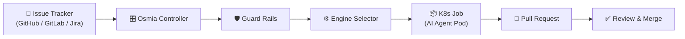

---
hide:
  - navigation
---

# Osmia

Osmia runs AI coding agents (Claude Code, OpenAI Codex, Aider, OpenCode and Cline) against your tickets. Each task gets its own Kubernetes Job. The agent makes the change and opens a pull request, and guard rails check the work at several points along the way.

<div class="grid cards" markdown>

-   :material-rocket-launch:{ .lg .middle } **Quick start**

    ---

    Run Osmia locally with Docker Compose. No Kubernetes cluster is needed.

    [:octicons-arrow-right-24: Docker Compose quick start](getting-started/docker-compose.md)

-   :material-kubernetes:{ .lg .middle } **Deploy on Kubernetes**

    ---

    Install with Helm, connect GitHub Issues and Claude Code, and run your first task.

    [:octicons-arrow-right-24: Kubernetes quick start](getting-started/kubernetes.md)

-   :material-shield-check:{ .lg .middle } **Guard rails**

    ---

    Controller validation, engine hooks, repo-level rules, task profiles, quality gates and a progress watchdog.

    [:octicons-arrow-right-24: Guard rails overview](concepts/guardrails-overview.md)

-   :material-puzzle:{ .lg .middle } **Plugins**

    ---

    Ticketing, notifications, secrets, SCM, approvals and reviews are all plugins that talk to the controller over gRPC.

    [:octicons-arrow-right-24: Writing a plugin](plugins/writing-a-plugin.md)

</div>

## How it works



Osmia watches your issue tracker for labelled tickets and checks each one against the configured guard rails. It then starts a coding agent in a Kubernetes Job. When the agent finishes, a pull request is opened with the result.

## Key features

| Feature | Description |
|---|---|
| Multi-engine | Claude Code, Codex, Aider, OpenCode and Cline, with fallback chains |
| Defence in depth | Six independent guard rail layers limit what an agent can do |
| Plugin architecture | Ticketing, notifications, secrets, SCM, approvals and reviews are extended through gRPC plugins |
| Kubernetes-native | Operator pattern with Karpenter integration and KEDA scaling; leader election is on the roadmap |
| Observability | Prometheus metrics, structured JSON logging, Grafana dashboards |
| Multi-tenancy | Multi-tenancy config schema is parsed but not enforced at runtime; namespace-per-tenant isolation is planned |
| Security | Distroless images, read-only filesystems, drop-all capabilities; NetworkPolicies and gVisor sandboxing are available but disabled by default |

## Intelligent agent management

Osmia also watches agents while they run and keeps what it learns for later tasks. The subsystems are:

| Subsystem | Status | What it does |
|---|---|---|
| [Real-time agent coaching (PRM)](concepts/prm.md) | Active | Scores each tool call and sends the agent guidance when its recent steps look unproductive |
| [Episodic memory](concepts/memory.md) | Active | Keeps facts from earlier tasks (past failures, repo quirks, engine strengths) and adds them to future prompts |
| [LLM abstraction](concepts/llm.md) | Active | DSPy-inspired typed signatures, composable modules and budget-aware LLM calls, used by the other subsystems |
| [Causal diagnosis](concepts/diagnosis.md) | Active | Classifies why a task failed and writes corrective instructions for the retry |
| [Adaptive watchdog](concepts/guardrails-overview.md#layer-8-adaptive-watchdog-calibration) | Active | Learns what normal looks like for each repo, engine and task type, and adjusts anomaly thresholds to match |
| [Intelligent routing](concepts/engines.md#intelligent-routing) | Active | Picks the engine most likely to succeed, based on past results |
| [Cost estimation](concepts/estimator.md) | Active | Predicts cost and duration before launch, for example "Predicted: $12-18, 45-90 min" |
| [Competitive execution](concepts/engines.md#competitive-execution-tournaments) | Active | Runs several engines in parallel, judges the results and picks the best one |

## Project layout

The repository is organised as follows:

```
cmd/osmia/              — Main entrypoint for the controller binary
internal/                 — Private packages used only by the controller
  controller/             — controller-runtime reconciler (reconciliation loop)
  jobbuilder/             — Translates ExecutionSpecs into Kubernetes Jobs
  sandboxbuilder/         — Sandbox CR builder (gVisor / Kata runtime classes)
  taskrun/                — TaskRun state machine, idempotency, and store
  watchdog/               — Progress watchdog loop (loop/stall/thrash detection)
  agentstream/            — Real-time NDJSON streaming from agent pods
  config/                 — Configuration loading and validation
  metrics/                — Prometheus metric definitions
  webhook/                — Webhook receiver (GitHub / GitLab / Slack / Shortcut / generic)
  secretresolver/         — Task-scoped secret resolution and policy enforcement
  promptbuilder/          — Prompt construction with task profiles and workflows
  prm/                    — Process Reward Model for real-time agent coaching
  memory/                 — Episodic memory with temporal knowledge graph
  diagnosis/              — Causal failure diagnosis and informed retry
  routing/                — Engine fingerprinting and intelligent task routing
  estimator/              — Predictive cost and duration estimation
  tournament/             — Competitive execution with tournament selection
pkg/                      — Public packages importable by plugins and SDKs
  engine/                 — ExecutionEngine interface and built-in engine implementations
  plugin/                 — gRPC plugin host and all six plugin interfaces
proto/                    — Protobuf definitions (source of truth for all interfaces)
charts/osmia/           — Helm chart for deploying Osmia on Kubernetes
docker/                   — Dockerfiles for the controller and each engine
  controller/             — Multi-stage build producing a distroless controller image
  engine-claude-code/     — Claude Code engine container image
  engine-codex/           — OpenAI Codex engine container image
  engine-opencode/        — OpenCode engine container image
  engine-cline/           — Cline engine container image (community template)
examples/                 — Example configurations and plugin implementations
  github-slack/           — GitHub Issues + Slack notification example values
  gitlab-teams/           — GitLab Issues + Microsoft Teams example values
  enterprise/             — Enterprise deployment patterns
  karpenter/              — Karpenter NodePool example for agent workloads
  keda/                   — KEDA ScaledObject example for queue-based scaling
  plugins/                — Example third-party plugins (Jira, Teams)
hack/                     — Developer scripts and local development helpers
  kind-config.yaml        — Kind cluster configuration for local development
  values-dev.yaml         — Helm values overlay for local dev deployments
  values-live.yaml        — Helm values overlay for live end-to-end testing
  values-test.yaml        — Helm values overlay for integration test deployments
  setup-secrets.sh        — Interactive script to provision K8s secrets for testing
  run-integration-tests.sh — Orchestrated test runner with markdown report output
scripts/                  — Utility scripts (dependency installation)
tests/                    — Test suites
  integration/            — Integration tests (no cluster required)
  e2e/                    — End-to-end tests (require a Kind cluster)
docs/                     — Documentation source (this site)
```

## Licence

Osmia is released under the [Apache 2.0 licence](https://www.apache.org/licenses/LICENSE-2.0).
